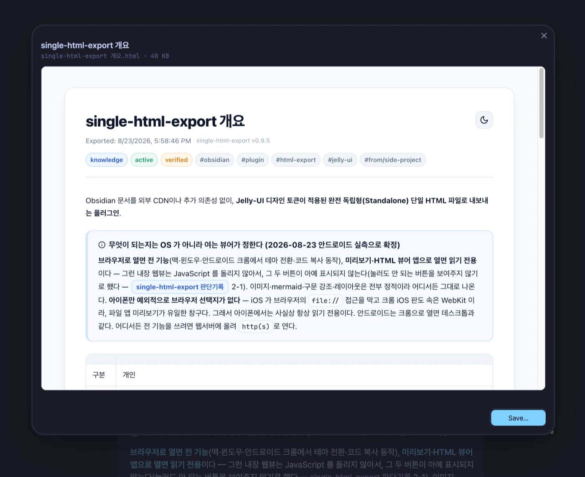
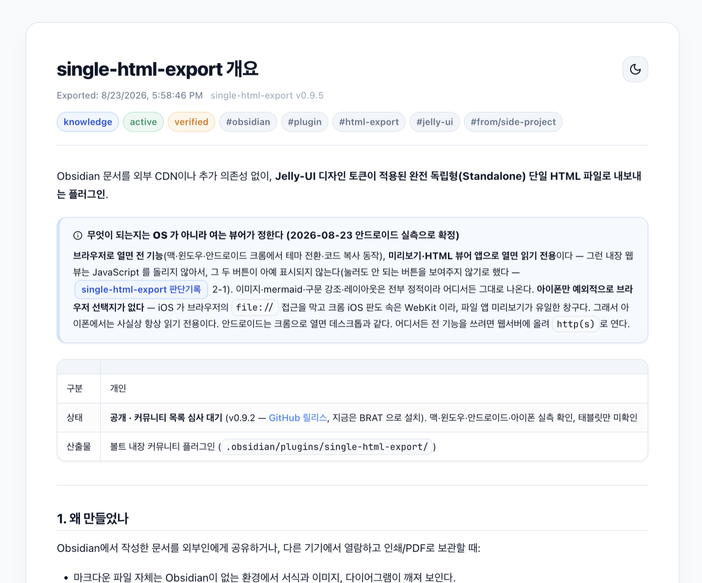

# Single HTML Export

문서 하나를 **완전히 독립된 단일 HTML 파일**로 내보냅니다 — 인터넷도, 첨부 폴더도, 외부 의존성도 필요 없습니다. 어디서든 열리고, 누구에게든 보낼 수 있습니다.

**데스크톱과 모바일 모두** 지원하며, iOS에서는 네이티브 공유 시트로 바로 넘깁니다.

*[English](README.md)*

| 파일을 만들기 전에 미리보기 | 내보낸 파일을 브라우저로 연 화면 |
|---|---|
|  |  |

## 기능

- **모든 것이 파일 하나에** — 이미지는 data URI로 임베드, Mermaid 다이어그램은 정적 SVG로 사전 렌더링, 구문 강조는 CSS로 번들. 오프라인에서 영구히 열립니다.
- **내보내기 전에 미리보기** — 커맨드를 실행하면 미리보기 팝업이 먼저 뜹니다. 버튼을 누르기 전에는 디스크에 아무것도 쓰지 않으므로, 그냥 닫으면 아무것도 남지 않습니다.
- **라이트 / 다크 테마 토글**이 내보낸 페이지에 내장됩니다.
- 모든 코드 블록에 **원클릭 복사 버튼**.
- **옵시디언 문법 지원** — 콜아웃, 위키링크, 체크박스 목록, 형광펜, 표, 프론트매터(메타데이터 칩 바로 표시).
- **인쇄 친화** — 내보낸 페이지를 인쇄하면 항상 라이트 팔레트로 나갑니다.
- **이중 언어 UI** — 옵시디언 언어 설정을 따라갑니다 (한국어 / 영어).

## 사용법

1. 문서를 열고 **HTML로 내보내기**를 실행합니다:
   - 커맨드 팔레트,
   - 파일 탐색기·탭 우클릭 메뉴,
   - 에디터 우클릭 메뉴.
2. 팝업에서 미리보기를 확인합니다.
3. 버튼을 고릅니다. 버튼은 그 기기가 실제로 지원하는 것만 뜹니다:

| 플랫폼 | 동작 |
|---|---|
| Windows / macOS / Linux | **저장…** — 위치 선택 후 **폴더에서 보기** |
| iOS / iPadOS | **공유** — 네이티브 공유 시트로 (AirDrop, 메시지, 파일 앱, …) |
| Android | **공용 폴더에 저장** — `Download/Obsidian HTML/` 에 저장하고 경로를 복사. 파일 관리자에서 열어 공유합니다 |

### 부가 커맨드

| 커맨드 | 설명 |
|---|---|
| 모바일 공유 수단 진단 | 이 기기가 제공하는 내보내기 수단을 보여줍니다 |
| 볼트에 남은 내보낸 HTML 정리 | 옛 버전이 볼트 안에 만든 HTML 파일을 휴지통으로 옮깁니다 |

## 내보낸 페이지의 버튼이 안 보일 때

iOS 파일 앱 미리보기나 단순 HTML 뷰어 앱은 JavaScript를 실행하지 않습니다. 그런 뷰어에서도 문서는 온전히 읽히지만, 테마 토글과 복사 버튼은 **일부러 숨겨집니다** — 눌러도 아무 일 없는 버튼을 보여주지 않기 위해서입니다. 같은 파일을 일반 브라우저로 열면 전부 동작합니다.

## 제약

- 안드로이드에서는 옵시디언 앱이 플러그인에 공유 시트를 열어주지 않아, 대신 공용 폴더에 저장합니다.
- 폰트는 임베드하지 않습니다(한글 폰트는 파일당 1~2 MB가 늘어납니다). [Pretendard](https://github.com/orioncactus/pretendard)가 설치된 기기에서는 그것을, 아니면 시스템 폰트를 씁니다.
- 내부 위키링크는 스타일만 유지한 텍스트로 남습니다 — 볼트 밖에서는 가리킬 곳이 없기 때문입니다.

## 설치

**커뮤니티 플러그인 목록에서** (승인 후): 설정 → 커뮤니티 플러그인 → 탐색 → "Single HTML Export" 검색.

**BRAT으로**: [BRAT](https://github.com/TfTHacker/obsidian42-brat)에 `DDEOK/Obsidian-Single-HTML-Export` 추가.

**수동으로**: [최신 릴리스](https://github.com/DDEOK/Obsidian-Single-HTML-Export/releases)에서 `main.js`, `manifest.json`, `styles.css`를 받아 `<볼트>/.obsidian/plugins/single-html-export/` 에 넣습니다.

## 개발

빌드 단계 없는 순수 JavaScript 파일 하나입니다. 저장소를 클론해 `main.js`를 고친 뒤, `main.js`·`manifest.json`·`styles.css`를 `<볼트>/.obsidian/plugins/single-html-export/` 에 복사하고 플러그인을 다시 로드하면 됩니다.

기여자를 위한 플랫폼 노트 둘:

- 데스크톱 전용 기능(저장 다이얼로그, 폴더에서 보기)은 `Platform.isDesktopApp` 뒤에 있습니다.
- 안드로이드 파일 접근은 옵시디언 모바일 앱이 노출하는 Capacitor `Filesystem` 브리지를 쓰며, 런타임에 feature-detect 합니다. 없으면 미리보기 전용으로 동작합니다.

## 고지

이 플러그인이 번들하거나 참조하는 서드파티 작업입니다. 같은 고지가 내보낸 모든 HTML 파일 안에도 들어갑니다.

- [Lucide](https://lucide.dev) (ISC) — 인라인 SVG 아이콘. © Lucide Icons and Contributors, Feather 유래 아이콘 © Cole Bemis (MIT).
- [jelly-ui](https://jelly-ui.com) (MIT) — 내보낸 페이지가 따르는 디자인 토큰·컴포넌트 어휘.
- [Pretendard](https://github.com/orioncactus/pretendard) (SIL OFL 1.1) — `local()`로 이름만 참조, 임베드하지 않음.

구문 강조는 옵시디언이 내주는 Prism 토큰 클래스를 재사용하고, Mermaid는 옵시디언 자체 엔진이 렌더합니다 — 두 라이브러리 모두 번들하지 않습니다.

## 라이선스

[MIT](LICENSE) © [DDEOK](https://github.com/DDEOK)
