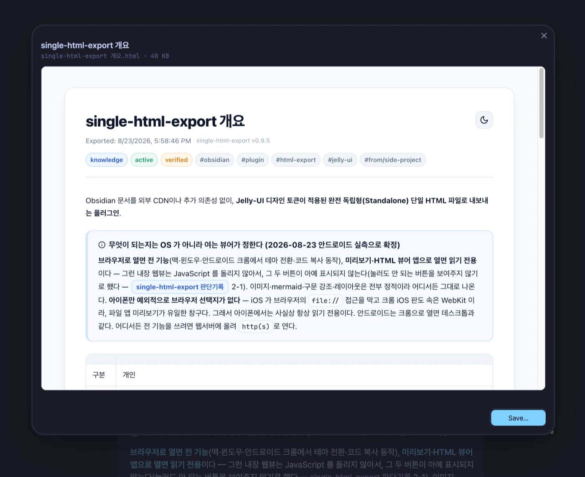
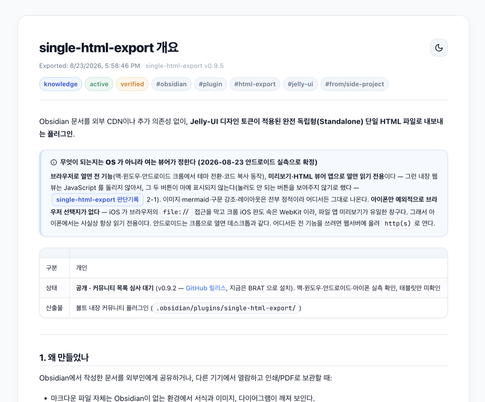

# Single HTML Export

Export any note as a **single, self-contained HTML file** — no internet, no asset folder, no external dependencies. Open it anywhere, share it with anyone.

Works on **desktop and mobile**, including a native share sheet on iOS.

*[한국어](README.ko.md)*

| Preview before anything is written | The exported file, opened in a browser |
|---|---|
|  |  |

## Features

- **Everything in one file** — images are embedded as data URIs, Mermaid diagrams are pre-rendered to static SVG, syntax highlighting is bundled as CSS. The file opens offline, forever.
- **Preview before you export** — running the command opens a preview popup first. Nothing is written to disk until you choose an action; close the popup and nothing is left behind.
- **Light / dark theme toggle** built into the exported page.
- **One-click code copy** buttons on every code block.
- **Obsidian syntax support** — callouts, wikilinks, task lists, highlights, tables, and frontmatter (rendered as a metadata chip bar).
- **Print-friendly** — printing an exported page always uses the light palette.
- **Bilingual UI** — follows your Obsidian language setting (English / Korean).

## Usage

1. Open a note, then run **Export to single HTML** from:
   - the command palette,
   - the file explorer / tab context menu, or
   - the editor context menu.
2. Check the preview in the popup.
3. Pick an action. The buttons shown depend on what your device supports:

| Platform | Actions |
|---|---|
| Windows / macOS / Linux | **Save…** — choose a location, then **Show in folder** |
| iOS / iPadOS | **Share** — hands the file to the native share sheet (AirDrop, Messages, Files, …) |
| Android | **Save to shared folder** — writes to `Download/Obsidian HTML/` and copies the path, so you can open and share it from your file manager |

### Additional commands

| Command | Description |
|---|---|
| Diagnose export options | Shows which export capabilities this device provides |
| Clean up exported HTML in the vault | Moves HTML files created by older versions of this plugin into the vault trash |

## Why the exported controls sometimes don't appear

Some viewers — the iOS Files preview, simple HTML viewer apps — don't run JavaScript. In those viewers the exported page is fully readable, but the theme toggle and copy buttons are hidden on purpose, so you never see a button that does nothing. Open the same file in a regular browser and everything works.

## Limitations

- On Android, the Obsidian app does not expose a native share sheet to plugins, so the plugin saves to a shared folder instead.
- Fonts are not embedded (embedding CJK fonts would add 1–2 MB per file). The page uses [Pretendard](https://github.com/orioncactus/pretendard) if installed, otherwise your system fonts.
- Internal wikilinks are kept as styled text — they have nowhere to point outside your vault.

## What the plugin touches

The community directory scan flags the capabilities below. Here is what each one is for.

| Capability | Why |
|---|---|
| **Filesystem outside the vault** | Only on desktop, and only after you pick a location in the save dialog — the file you asked for is written with Node's `fs`. Obsidian has no API for writing outside the vault. On Android the same role is played by the Capacitor `Filesystem` bridge, writing to `Download/Obsidian HTML/`. |
| **Clipboard** | Write only, never read. The saved path is copied so you can paste it into a file manager, and the diagnostics command copies its report. |
| **Local storage** | The plugin stores nothing. It reads the app's own language setting as a fallback when the locale isn't otherwise available. The exported page uses `localStorage` for its own theme toggle, but that runs in the exported file — not inside Obsidian. |

Nothing is sent anywhere: the plugin makes no network requests, and an exported file has no external references.

## Installation

**From the community plugin directory** (once approved): Settings → Community plugins → Browse → search "Single HTML Export".

**With BRAT**: add `DDEOK/Obsidian-Single-HTML-Export` in [BRAT](https://github.com/TfTHacker/obsidian42-brat).

**Manually**: download `main.js`, `manifest.json`, and `styles.css` from the [latest release](https://github.com/DDEOK/Obsidian-Single-HTML-Export/releases) into `<vault>/.obsidian/plugins/single-html-export/`.

## Development

The plugin is a single plain-JavaScript file — no build step. Clone the repo, edit `main.js`, then copy `main.js`, `manifest.json`, and `styles.css` into `<vault>/.obsidian/plugins/single-html-export/` and reload the plugin.

Two platform notes for contributors:

- Desktop-only features (save dialog, "Show in folder") are gated behind `Platform.isDesktopApp`.
- Android file access uses the Capacitor `Filesystem` bridge exposed by the Obsidian mobile app, feature-detected at runtime. When it's absent the plugin degrades to preview-only.

## Acknowledgements

This plugin bundles or references the following third-party work. The same notices are embedded in every exported HTML file.

- [Lucide](https://lucide.dev) (ISC) — inline SVG icons. © Lucide Icons and Contributors; Feather-derived icons © Cole Bemis (MIT).
- [jelly-ui](https://jelly-ui.com) (MIT) — the design token and component vocabulary the exported page follows.
- [Pretendard](https://github.com/orioncactus/pretendard) (SIL OFL 1.1) — referenced by name via `local()`, not embedded.

Syntax highlighting reuses the Prism token classes Obsidian emits, and Mermaid diagrams are rendered by Obsidian's own engine — neither library is bundled.

## License

[MIT](LICENSE) © [DDEOK](https://github.com/DDEOK)
